<div align="center">

<a href="https://velia.lucidlakelabs.com">
  <picture>
    <source media="(prefers-color-scheme: dark)" srcset="brand/velia-lockup-plush.svg">
    
  </picture>
</a>

### Sail a real lake in your browser.

**[▶ Play now at velia.lucidlakelabs.com](https://velia.lucidlakelabs.com)**

[](https://github.com/lucid-lake/velia/actions/workflows/ci.yml)
[](LICENSE)
[](v2/README.md)
[](https://ko-fi.com/lucidlake)

<a href="https://velia.lucidlakelabs.com">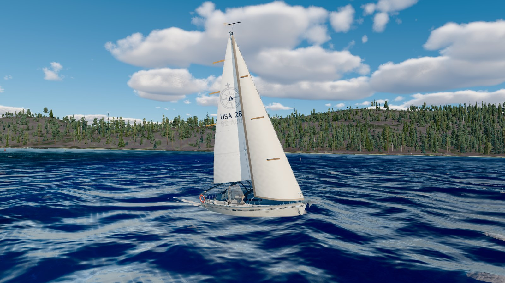</a>

</div>

## Watch

[](https://www.youtube.com/watch?v=hbosudzwbSk)

**▶ [Week 3 update](https://www.youtube.com/watch?v=hbosudzwbSk)** (2026-11-18). More videos: [July 4th fireworks and kayaks](https://www.youtube.com/watch?v=uqyhSGskhOs) (2026-11-11) · [Week 2 progress](https://www.youtube.com/watch?v=gvN_RuO8S2A) (2026-11-06) · [We built a sailing sim of Lake Tahoe](https://www.youtube.com/watch?v=MDWkyLbLV9g) (2026-11-01).

## What Velia is

- **A real place.** You sail Emerald Bay on Lake Tahoe. The terrain, the lake bed, the forest and the light come from real data.
- **Real wind and water.** Wind is one system, and every effect reads it. The waves are wind-driven. The boat sails by its polars.
- **Three modes.** **Sail**: the lake is yours, with no score and no timer. **Cruise**: an autopilot sails, the music plays. **Regatta**: race computer boats round the marks.
- **Or be the monster.** Tahoe's legend, Tessie, lives in the bay. When she surfaces, press T and you are her: swim, dive, rise and knock boats over.
- **A living lake.** A glass-bottom tour boat with clear kayaks, other sailboats, fireworks on July 4th, storms, rainbows and the Milky Way.
- **Its own engine.** Raw WebGPU and WGSL, no three.js. It runs in a recent Chrome, Edge or Safari.

## Play as Tessie

<table>
<tr>
<td width="50%"><a href="docs/album/02-tessie-rising.jpg">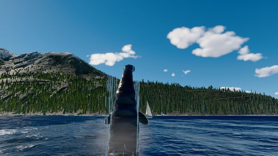</a></td>
<td width="50%"><a href="docs/album/03-tessie-deep.jpg">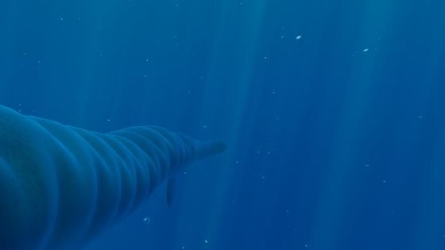</a></td>
</tr>
</table>

Lake Tahoe has a monster story. In Velia you can play it. Tessie is a creature mode on a desktop or a tablet.

- **Become her.** When she shows herself near your boat, press **T**. Or pick **Tessie** beside the Halcyon on the start panel and press **Dive in**. **T** again hands you back the helm.
- **Swim and dive.** **W A S D** swim. **Q** dives and **E** rises. She is slow and heavy at the surface and fast under it. **1** or **Shift** is a dash. **C** switches between her eyes and the view behind her. On a tablet: a thumbstick and a Bite button.
- **Strike.** **Space** or a click bites. Bite a sailboat, or rise under its hull, and it goes over with a splash. It rights itself and sails on. Kayakers only get splashed.
- **The skipper runs.** While you are Tessie, your own boat's skipper takes the Halcyon and tries to get away from you.
- **Tessie's Deep.** A Regatta race in her water. She hunts the fleet the whole race. Tack or bear away when she comes for you.
- **The hunts.** Chart the Bay and Chart the Mouth: eight hidden corners each, found by sailing there. One of them is seeing Tessie.

## Album

Every picture is a frame from the game, captured with the HUD off. Nothing is painted over. Tap a picture for the full size. Tessie's two are above.

<table>
<tr>
<td width="50%"><a href="docs/album/01-rainbow.jpg">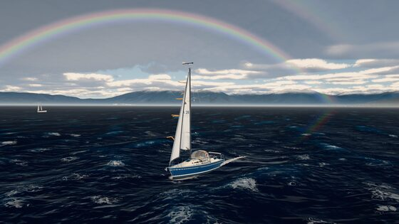</a><br><sub>After the storm, a rainbow over the open lake.</sub></td>
<td width="50%"><a href="docs/album/04-cockpit.jpg">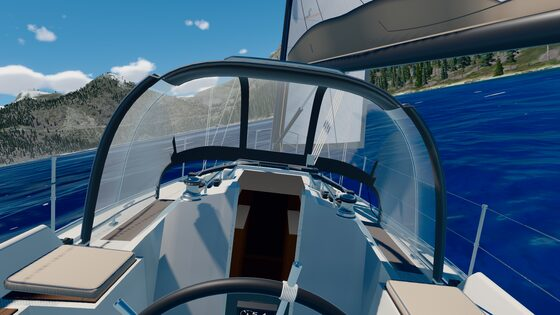</a><br><sub>At the helm: the cockpit, the wheel, the bay ahead.</sub></td>
</tr>
<tr>
<td><a href="docs/album/05-fireworks.jpg">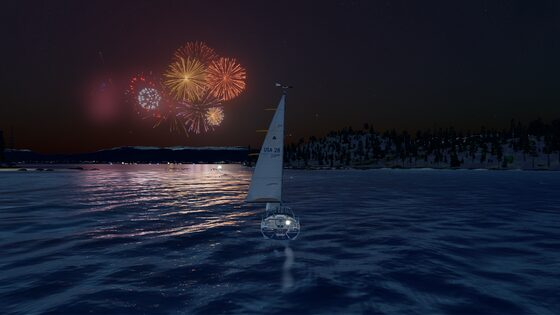</a><br><sub>July 4th: the fireworks off the mouth of Emerald Bay.</sub></td>
<td><a href="docs/album/06-milky-way.jpg">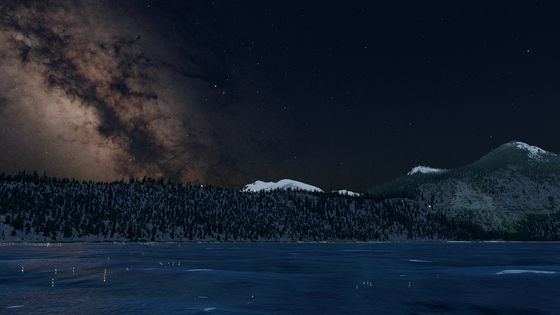</a><br><sub>The Milky Way over the ridge, from the deck at 22:30.</sub></td>
</tr>
<tr>
<td><a href="docs/album/07-heeled.jpg"></a><br><sub>A fresh afternoon breeze. The boat sails by its polars.</sub></td>
<td><a href="docs/album/08-regatta.jpg">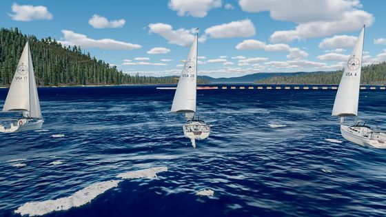</a><br><sub>Regatta: three boats at the start line.</sub></td>
</tr>
<tr>
<td><a href="docs/album/09-ski-run.jpg">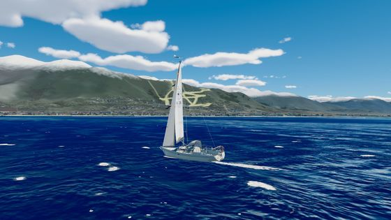</a><br><sub>Off Ski Run, South Lake Tahoe, under the ski slopes.</sub></td>
<td><a href="docs/album/10-storm.jpg">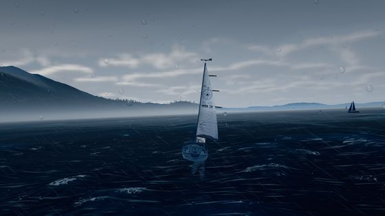</a><br><sub>A storm rolls in. Rain hits the lens.</sub></td>
</tr>
<tr>
<td><a href="docs/album/11-glass-kayak.jpg">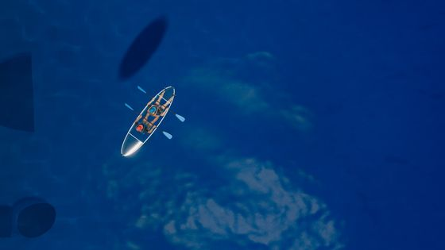</a><br><sub>A clear kayak from the glass-bottom tour, seen from above.</sub></td>
<td><a href="docs/album/12-glass-boat-night.jpg">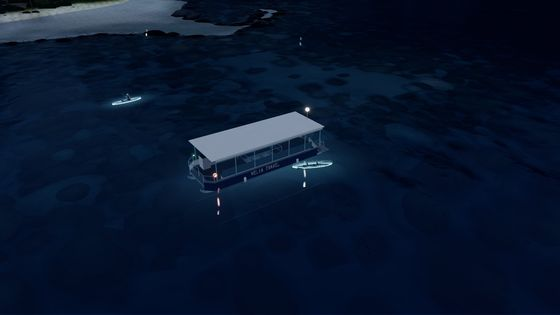</a><br><sub>The tour boat at night. Its kayaks glow on the dark water.</sub></td>
</tr>
</table>

## Run

You need Node.js 24 or newer and a browser with WebGPU.

```sh
npm ci
npm run dev:v2      # Velia at http://127.0.0.1:5174/
npm run build:v2    # dist-v2/: the game, its worker and the data it streams
```

The classic version (v1) still builds: `npm run dev` (port 5173) and `npm run build` (`dist/`).

## Test

```sh
npm run test:v2     # v2's fast suite (v2/tests/, no browser, about 20 s)
npm test            # the shared modules and both trees (about 25 s)
```

- Slower lanes: `npm run test:v2:slow`, `npm run test:slow`, `npm run test:classic`.
- With a GPU: the page tests (`npm run test:pages:v2`) and the golden frames (`npm run goldens:v2`) drive a headless browser.
- CI runs the fast suites and both builds on every push and pull request (`.github/workflows/ci.yml`).
- Tests check behaviour (call the module, read its output, DOM or state), never the source text. A refactor that keeps the behaviour stays green.

## Architecture

[`v2/README.md`](v2/README.md) is the engine's map: the mode table, the plug-in list, the played seam, the region table and the import directions. [`v2/notes/`](v2/notes/INDEX.md) holds one file per subsystem.

| Folder | What |
|---|---|
| `v2/` | Velia: boot, the launch gate and the page |
| `v2/engine/` | device, frame graph, pipelines, governor, quality ladder, clock, flags, mode table, plug-ins |
| `v2/sim/` | pure simulation: boat, wind, waves, clouds, regions, kayaks (no DOM, no GPU) |
| `v2/render/` | GPU passes: terrain, forest, water, sky, clouds, night, storm, boat, cockpit, wake, birds |
| `v2/terrain/`, `forest/`, `towns/`, `photo/` | streamed lake data and its decoders |
| `v2/audio/`, `v2/ui/` | sound and music; HUD, cockpit, chart, logbook, touch controls |
| `v2/cruise/`, `regatta/`, `stage/`, `living/` | the modes, the stage venues, the living lake |
| `src/` | modules both versions read (wind, day, flags, lake and vessel profiles, `src/sim/`) |
| `classic/` | the classic version (three.js 0.184 `three/webgpu` + TSL), frozen |
| `terrain/`, `data/`, `models/`, `audio/`, `fonts/`, `brand/` | assets the pages fetch by absolute URL |
| `tools/` | build scrub, packers, capture and golden tools, bakes the tests check |

Every URL flag is a row of a flag table (`v2/engine/flags.js`, `V2_ROWS`). Scenes are deterministic: `?hour=6.5&cam=A&seed=1&headless=1` gives the same frame every time.

## Support Velia

Velia is free to play. A coffee keeps the lake open.

<a href="https://ko-fi.com/lucidlake"></a>

## Contributing

- **Issues are welcome:** bugs, a device where the game will not start, a sailing detail that is wrong.
- **Pull requests are by invitation for now.** Open an issue first. See [`CONTRIBUTING.md`](CONTRIBUTING.md).
- **Security reports:** [`SECURITY.md`](SECURITY.md).

Before your first commit, turn on the repo's hooks. They scan each commit and push for secrets, local paths and private data.

```sh
git config core.hooksPath .githooks
```

## Credits and licence

- **Code:** MIT ([`LICENSE`](LICENSE)), by Lucid Lake Studio.
- **Album pictures** (`docs/album/`): our own renders of the game, MIT. The Velia mark on the sails stays a trademark ([`NOTICE.md`](NOTICE.md)).
- **Third-party data, sounds, fonts and textures** keep their own licences: [`ATTRIBUTION.md`](ATTRIBUTION.md) lists each one, [`LICENSES/`](LICENSES/) holds the texts.
- **Not covered by the MIT licence:** the AI-generated music (MusicAPI) and images (Gemini), and the Velia and Lucid Lake names and logos. They ship with the game; see [`NOTICE.md`](NOTICE.md).

Contact: [contact@lucidlakelabs.com](mailto:contact@lucidlakelabs.com)
